# Card catalog

Generated from `Server/src/cards/catalog.ts` by `npm run catalog:doc` — edit the catalog, not this file.
Printed text is transcribed exactly from `All Cards.pdf`; artwork is cropped from the same PDF by `tools/extract_assets.py`.
Rule-audit ids (A*, C*) point to [rule-audit.md](rule-audit.md). Handlers: `Server/src/game/effects/`.

## Noble deck — 74 cards, 28 faces

| Art | Card | Printed text | Targets | What the engine does | Rule audit |
|---|---|---|---|---|---|
| 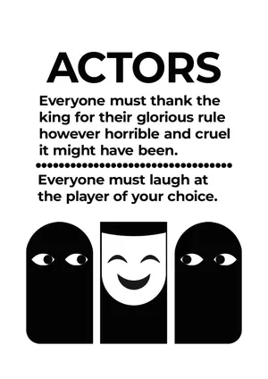 | **Actors** `noble:actors` ×3 | **1.** Everyone must thank the king for their glorious rule however horrible and cruel it might have been. **2.** Everyone must laugh at the player of your choice. | Option 2: any other player. | No gold changes. Everyone asked gets a one-tap line to say (posted to the table). | C12 |
| 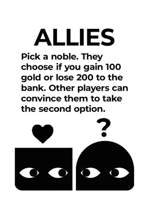 | **Allies** `noble:allies` ×3 | Pick a noble. They choose if you gain 100 gold or lose 200 to the bank. Other players can convince them to take the second option. | Another Noble. | The Noble chooses: you gain 100 from the bank, or you lose 200 to the bank. | C11 |
| 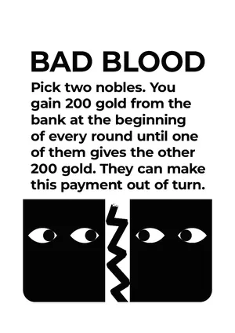 | **Bad Blood** `noble:bad_blood` ×3 | Pick two nobles. You gain 200 gold from the bank at the beginning of every round until one of them gives the other 200 gold. They can make this payment out of turn. | Two other Nobles. | Lasting: +200 to you at the start of each later round until either of the two pays the other 200. | C4 |
| 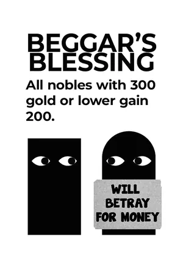 | **Beggar's Blessing** `noble:beggars_blessing` ×3 | All nobles with 300 gold or lower gain 200. | None. | Every Noble with ≤300 gains 200 from the bank. |  |
| 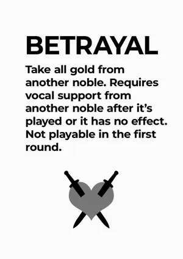 | **Betrayal** `noble:betrayal` ×4 | Take all gold from another noble. Requires vocal support from another noble after it's played or it has no effect. Not playable in the first round. | Another Noble. | You name the Noble who backed you; once they confirm, you take all their gold unless a real Knight is in front of them. Timing: Rounds 2–4. | A8, C1 |
| 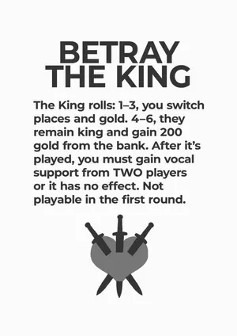 | **Betray the King** `noble:betray_the_king` ×2 | The King rolls: 1–3, you switch places and gold. 4–6, they remain king and gain 200 gold from the bank. After it's played, you must gain vocal support from TWO players or it has no effect. Not playable in the first round. | The King. | You name your two backers and both confirm, King Maker window, King rolls: ≤3 you become King and swap gold; ≥4 the King gains 200. Timing: Rounds 2–4. Dice: The King rolls (King Maker modifies it). | C1, C2 |
| 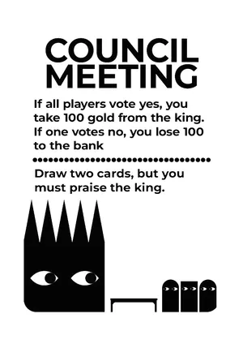 | **Council Meeting** `noble:council_meeting` ×3 | **1.** If all players vote yes, you take 100 gold from the king. If one votes no, you lose 100 to the bank **2.** Draw two cards, but you must praise the king. | None. | Option 1: the other Nobles vote (not the King); all yes → take 100 from the King, any no → lose 100. Option 2: praise the King and draw 2 cards — refuse and draw nothing. | A12, C12, C19, C20 |
| 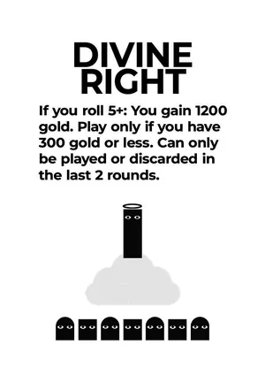 | **Divine Right** `noble:divine_right` ×1 | If you roll 5+: You gain 1200 gold. Play only if you have 300 gold or less. Can only be played or discarded in the last 2 rounds. | None. | Roll 5+ → gain 1200 from the bank. Timing: Rounds 3–4, only with ≤300 gold. Dice: You roll: 5–6 wins. |  |
| 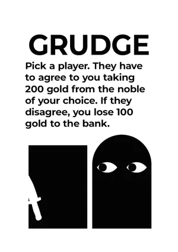 | **Grudge** `noble:grudge` ×2 | Pick a player. They have to agree to you taking 200 gold from the noble of your choice. If they disagree, you lose 100 gold to the bank. | A judge (any other player) and a victim (another Noble). | The judge agrees → you take 200 from the victim; disagrees → you lose 100. | A12, C11 |
| 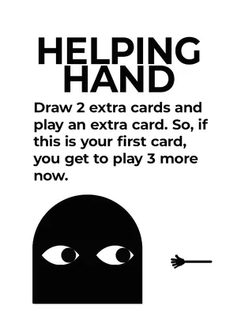 | **Helping Hand** `noble:helping_hand` ×3 | Draw 2 extra cards and play an extra card. So, if this is your first card, you get to play 3 more now. | None. | Draw 2 now; doesn't count as a play and gives +1 play this turn. | A5 |
| 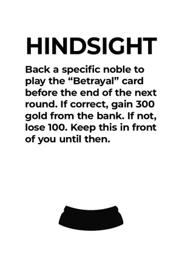 | **Hindsight** `noble:hindsight` ×2 | Back a specific noble to play the "Betrayal" card before the end of the next round. If correct, gain 300 gold from the bank. If not, lose 100. Keep this in front of you until then. | Another Noble. | Stays in front of you: +300 when they play a Betrayal, −100 if they haven't by the end of next round. | C3 |
| 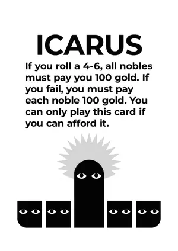 | **Icarus** `noble:icarus` ×2 | If you roll a 4-6, all nobles must pay you 100 gold. If you fail, you must pay each noble 100 gold. You can only play this card if you can afford it. | All other Nobles. | Win → take 100 from each other Noble; lose → pay each other Noble 100. Timing: Only with ≥100 × other Nobles. Dice: You roll: 4–6 wins. | A12, C17 |
| 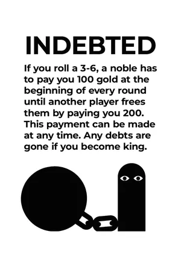 | **Indebted** `noble:indebted` ×2 | If you roll a 3-6, a noble has to pay you 100 gold at the beginning of every round until another player frees them by paying you 200. This payment can be made at any time. Any debts are gone if you become king. | Another Noble (the debtor). | Lasting debt: the debtor pays you 100 at the start of each later round until someone else pays you 200. Dice: You roll: 3–6 wins. | C4 |
| 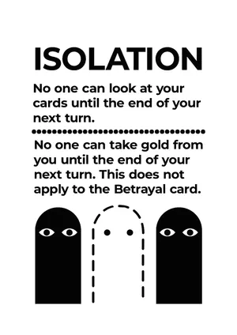 | **Isolation** `noble:isolation` ×3 | **1.** No one can look at your cards until the end of your next turn. **2.** No one can take gold from you until the end of your next turn. This does not apply to the Betrayal card. | Yourself. | A protection on you until the end of your next turn. | A12, A13, C13 |
| 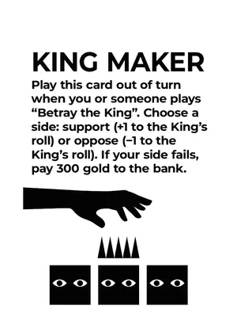 | **King Maker** `noble:king_maker` ×2 | Play this card out of turn when you or someone plays "Betray the King". Choose a side: support (+1 to the King's roll) or oppose (−1 to the King's roll). If your side fails, pay 300 gold to the bank. | A side. | ±1 on the King's roll; the losing side pays 300. Timing: Only in the King Maker window of a Betray the King. | C2 |
| 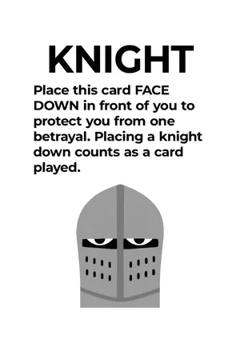 | **Knight** `noble:knight` ×2 | Place this card FACE DOWN in front of you to protect you from one betrayal. Placing a knight down counts as a card played. | Yourself. | Face down in front of you; blocks one Betrayal. | A8, A9 |
| 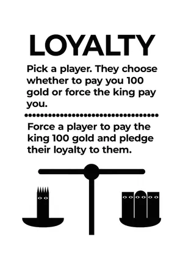 | **Loyalty** `noble:loyalty` ×3 | **1.** Pick a player. They choose whether to pay you 100 gold or force the king pay you. **2.** Force a player to pay the king 100 gold and pledge their loyalty to them. | Option 1: any other player. Option 2: another Noble. | Option 1: they choose who pays you 100 (them or the King). Option 2: they pay the King 100 and pledge loyalty. | A12, C11, C12 |
| 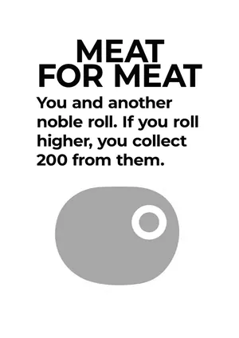 | **Meat for Meat** `noble:meat_for_meat` ×4 | You and another noble roll. If you roll higher, you collect 200 from them. | Another Noble. | Higher roll than them → take 200 from them. Dice: You and the Noble roll. | A12 |
| 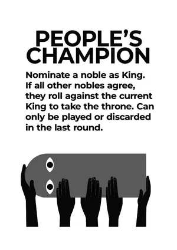 | **People's Champion** `noble:peoples_champion` ×1 | Nominate a noble as King. If all other nobles agree, they roll against the current King to take the throne. Can only be played or discarded in the last round. | Any Noble (you may nominate yourself). | Unanimous Noble vote → nominee and King roll; higher roll takes the throne. Timing: Round 4. Dice: Nominee vs King. | A1, C5 |
| 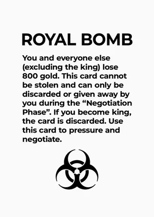 | **Royal Bomb** `noble:royal_bomb` ×1 | You and everyone else (excluding the king) lose 800 gold. This card cannot be stolen and can only be discarded or given away by you during the "Negotiation Phase". If you become king, the card is discarded. Use this card to pressure and negotiate. | All Nobles including you. | You and every other Noble lose 800 to the bank. | C15 |
| 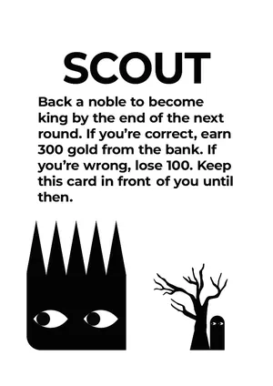 | **Scout** `noble:scout` ×2 | Back a noble to become king by the end of the next round. If you're correct, earn 300 gold from the bank. If you're wrong, lose 100. Keep this card in front of you until then. | Another Noble. | Stays in front of you: +300 when they become King, −100 if they haven't by the end of next round. | C3 |
| 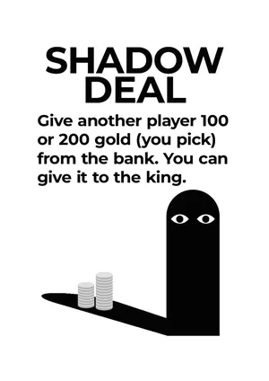 | **Shadow Deal** `noble:shadow_deal` ×5 | Give another player 100 or 200 gold (you pick) from the bank. You can give it to the king. | Any other player. | They gain 100 or 200 from the bank. |  |
| 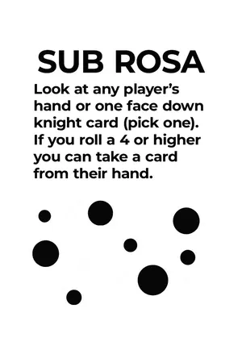 | **Sub Rosa** `noble:sub_rosa` ×5 | Look at any player's hand or one face down knight card (pick one). If you roll a 4 or higher you can take a card from their hand. | Another player's hand, or one face-down card. | Look privately; on 4+ take a card from that player's hand (chosen if you saw the hand, blind otherwise). Dice: You roll: 4–6 wins. | C8, C13 |
| 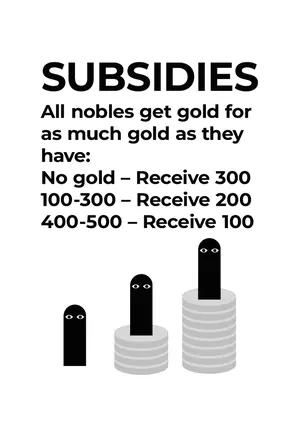 | **Subsidies** `noble:subsidies` ×3 | All nobles get gold for as much gold as they have: No gold – Receive 300 100-300 – Receive 200 400-500 – Receive 100 | None. | Every Noble: 0 → +300, 100–300 → +200, 400–500 → +100. |  |
| 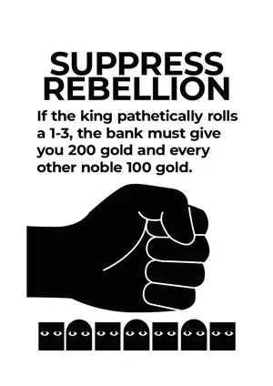 | **Suppress Rebellion** `noble:suppress_rebellion` ×2 | If the king pathetically rolls a 1-3, the bank must give you 200 gold and every other noble 100 gold. | None. | King rolls 1–3 → you +200, every other Noble +100. Dice: The King rolls: 1–3 wins. |  |
| 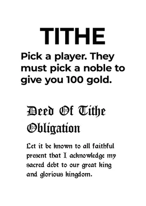 | **Tithe** `noble:tithe` ×2 | Pick a player. They must pick a noble to give you 100 gold. | Any other player picks a Noble (not you). | The picked Noble gives you 100. | A12, C11 |
| 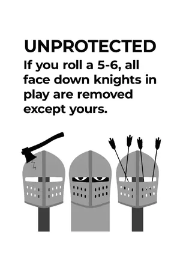 | **Unprotected** `noble:unprotected` ×2 | If you roll a 5-6, all face down knights in play are removed except yours. | None. | Every face-down card not in front of you is discarded unrevealed. Dice: You roll: 5–6 wins. | C18 |
| 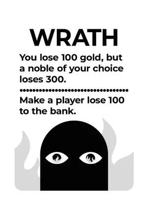 | **Wrath** `noble:wrath` ×4 | **1.** You lose 100 gold, but a noble of your choice loses 300. **2.** Make a player lose 100 to the bank. | Option 1: another Noble. Option 2: any other player. | Option 1: you −100, they −300. Option 2: they −100. |  |

## King deck — 25 cards, 16 faces

| Art | Card | Printed text | Targets | What the engine does | Rule audit |
|---|---|---|---|---|---|
| 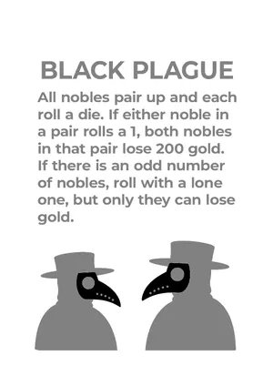 | **Black Plague** `king:black_plague` ×1 | All nobles pair up and each roll a die. If either noble in a pair rolls a 1, both nobles in that pair lose 200 gold. If there is an odd number of nobles, roll with a lone one, but only they can lose gold. | All Nobles, paired by the King. | A 1 in a pair → both Nobles of the pair −200. Dice: Every Noble rolls (the King too, with an odd number). | C6 |
| 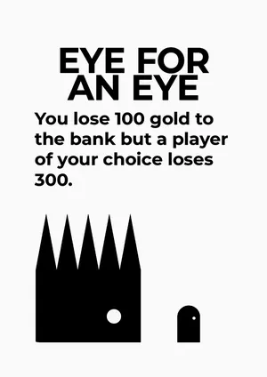 | **Eye for an Eye** `king:eye_for_an_eye` ×1 | You lose 100 gold to the bank but a player of your choice loses 300. | Any Noble. | You −100, they −300. |  |
| 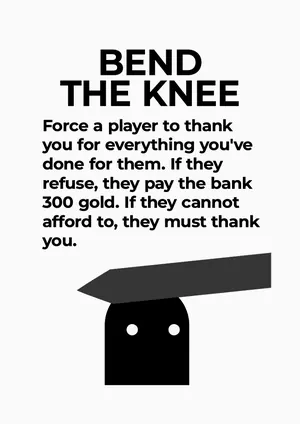 | **Bend the Knee** `king:bend_the_knee` ×2 | Force a player to thank you for everything you've done for them. If they refuse, they pay the bank 300 gold. If they cannot afford to, they must thank you. | Any Noble. | They thank you (said to the table) or pay 300. | C11, C12, C20 |
| 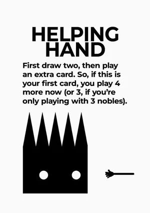 | **Helping Hand** `king:helping_hand` ×1 | First draw two, then play an extra card. So, if this is your first card, you play 4 more now (or 3, if you're only playing with 3 nobles). | None. | Draw 2 now; doesn't count as a play and gives +1 play this turn. | A5 |
| 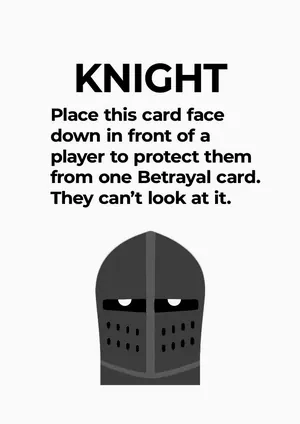 | **Knight** `king:knight` ×1 | Place this card face down in front of a player to protect them from one Betrayal card. They can't look at it. | A Noble. | Face down in front of them; blocks one Betrayal. Only you know what it is. | A8, A9 |
| 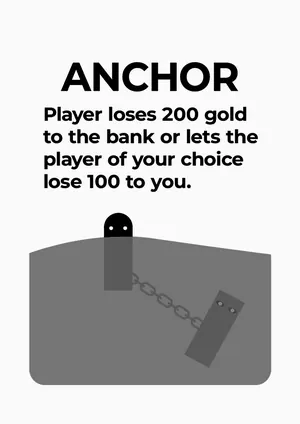 | **Anchor** `king:anchor` ×2 | Player loses 200 gold to the bank or lets the player of your choice lose 100 to you. | A Noble, plus a Noble of your choice. | The first Noble chooses: they lose 200, or the second loses 100 to you. | A12, C10 |
| 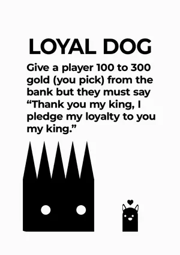 | **Loyal Dog** `king:loyal_dog` ×3 | Give a player 100 to 300 gold (you pick) from the bank but they must say "Thank you my king, I pledge my loyalty to you my king." | Any Noble. | They say the pledge and then gain 100/200/300 from the bank — refuse and they get nothing. | C12, C20 |
| 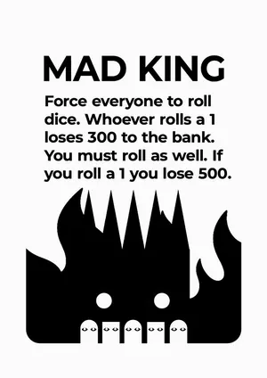 | **Mad King** `king:mad_king` ×1 | Force everyone to roll dice. Whoever rolls a 1 loses 300 to the bank. You must roll as well. If you roll a 1 you lose 500. | Everyone. | Nobles rolling 1 lose 300; you lose 500 on a 1. Dice: Everyone rolls. |  |
| 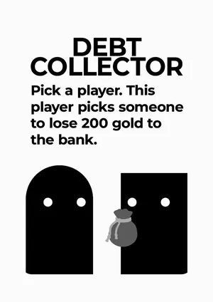 | **Debt Collector** `king:debt_collector` ×2 | Pick a player. This player picks someone to lose 200 gold to the bank. | A Noble, who picks anyone. | The picked player loses 200 to the bank. | C11 |
| 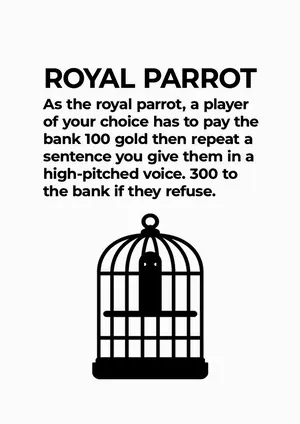 | **Royal Parrot** `king:royal_parrot` ×2 | As the royal parrot, a player of your choice has to pay the bank 100 gold then repeat a sentence you give them in a high-pitched voice. 300 to the bank if they refuse. | A Noble, plus your sentence. | They pay 100, then repeat your sentence or pay 300 more. | C11, C12, C20 |
| 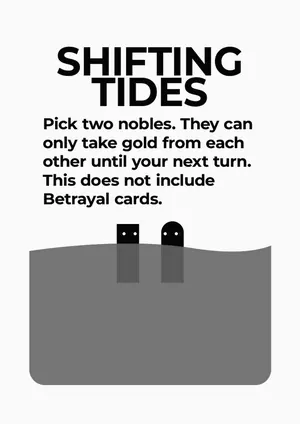 | **Shifting Tides** `king:shifting_tides` ×1 | Pick two nobles. They can only take gold from each other until your next turn. This does not include Betrayal cards. | Two Nobles. | Until your next turn, those two may only take gold from each other. | A12, A13, C14 |
| 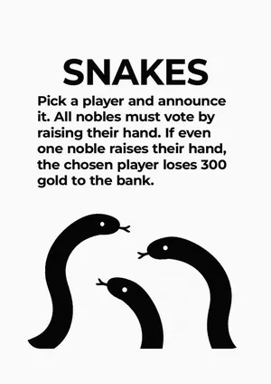 | **Snakes** `king:snakes` ×1 | Pick a player and announce it. All nobles must vote by raising their hand. If even one noble raises their hand, the chosen player loses 300 gold to the bank. | Any Noble. | Secret vote of all Nobles; one raised hand → they lose 300. |  |
| 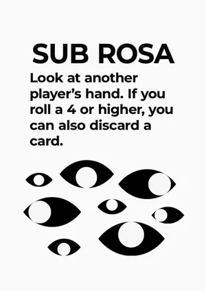 | **Sub Rosa** `king:sub_rosa` ×2 | Look at another player's hand. If you roll a 4 or higher, you can also discard a card. | A Noble's hand. | Look privately; on 4+ discard a card of your choice from it. Dice: You roll: 4–6 wins. | C9, C13 |
| 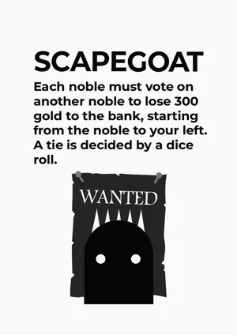 | **Scapegoat** `king:scapegoat` ×1 | Each noble must vote on another noble to lose 300 gold to the bank, starting from the noble to your left. A tie is decided by a dice roll. | All Nobles vote. | Most votes loses 300; ties → lowest roll among the tied. Dice: Only to break a tie. | C7 |
| 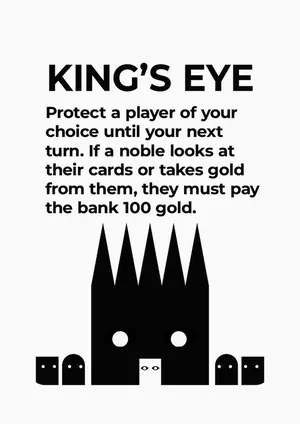 | **King's Eye** `king:kings_eye` ×2 | Protect a player of your choice until your next turn. If a noble looks at their cards or takes gold from them, they must pay the bank 100 gold. | Any player (you too). | Until your next turn, a Noble who looks at their cards or takes their gold pays 100. | A12, A13 |
| 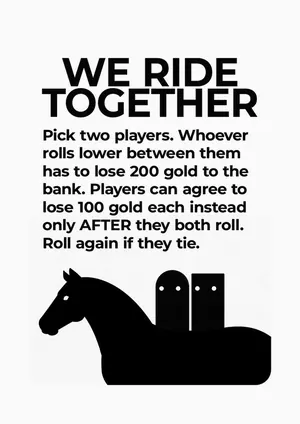 | **We Ride Together** `king:we_ride_together` ×2 | Pick two players. Whoever rolls lower between them has to lose 200 gold to the bank. Players can agree to lose 100 gold each instead only AFTER they both roll. Roll again if they tie. | Two players. | Lower roll −200, unless both agree to −100 each. Dice: Both players roll. | C11 |
